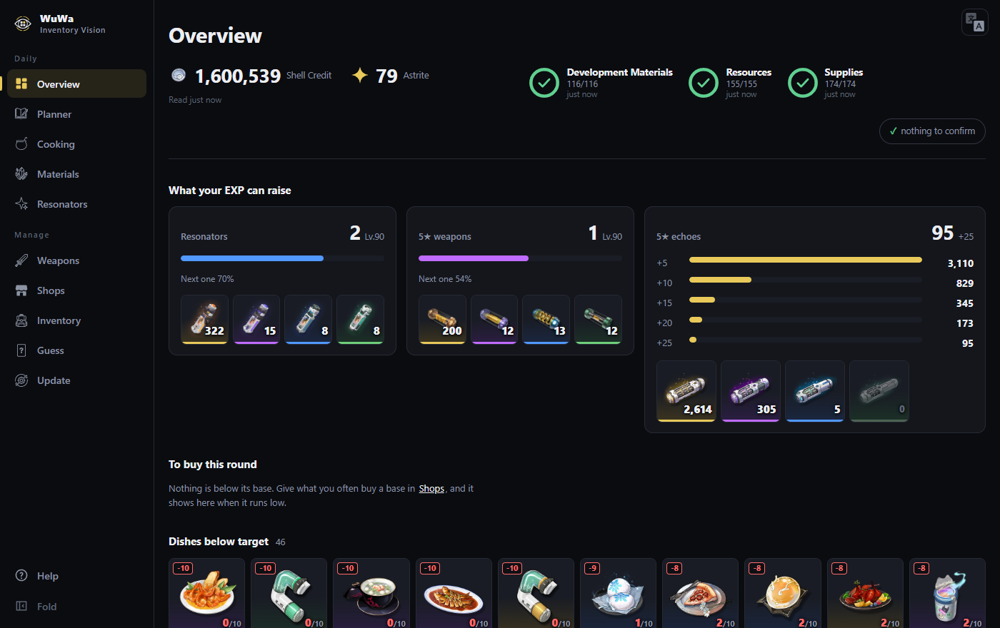
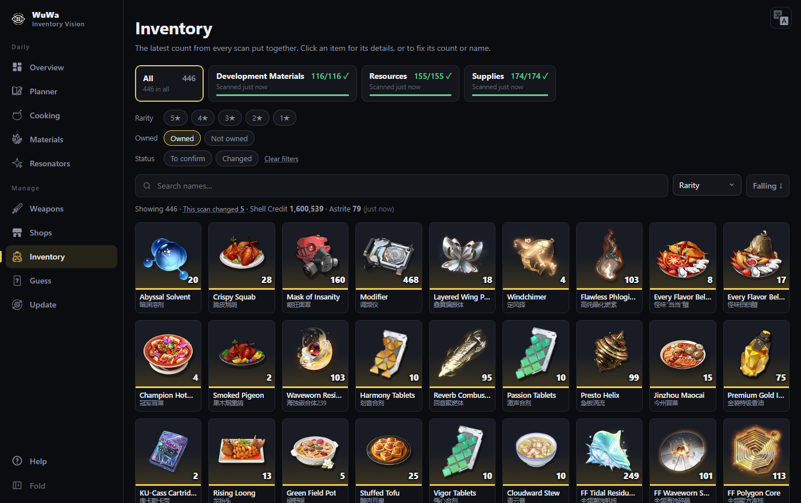
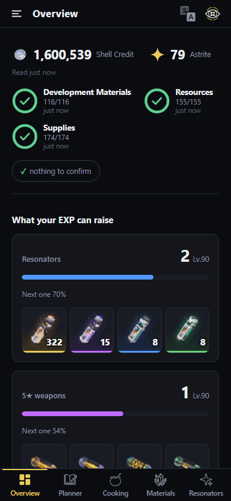

# WuWa Inventory Vision

**English** · [中文](README.zh-CN.md)

**Step-by-step guide, with pictures:** <https://oguessyky.github.io/wuwa-inventory-vision/en/>

**A free Wuthering Waves inventory scanner and planner that knows what is in your bag.** You scroll through
your in-game inventory once, and it reads every item and its count off the screen. Then it shows
you what you can level with what you have, what each resonator and weapon still needs, what you
are short of, and what to farm or buy next. It runs on your own computer (Windows or Mac), and you
can look at the results on your phone too. It only looks at the screen: it never touches the
game's files, memory or network traffic, and it never plays the game for you.



## What it is for

- **No more counting by hand.** Open the bag, scroll each tab, press F9. Every item's name, rarity
  and count is read, and for weapons the level, refinement and who has it equipped. The game's own
  item count says when a scan is complete.
- **What to farm next.** Every material against every build, with synthesis counted: what each
  resonator and weapon still needs, and what you are short of across all of them.
- **Plans and shopping.** Plan a resonator or weapon from where it is to where you want it, and
  see what each shop sells, its limits and prices, and what you are running low on.
- **On a phone, in Chinese or English.** Every page fits a phone, every page is in both
  languages, and everything is found by Chinese, pinyin, initials or English.

## Is it safe?

It reads **screen pixels only**: no memory reads, no injection, no packet capture, no changes to
the game. Nothing it does changes your account, and it never moves your character or fights. Your
player ID is removed from every picture before it is saved or shown. Everything stays on your own
computer; the few times it uses the internet (downloading the item catalogue, updating itself)
are each started by you. [PRIVACY.md](PRIVACY.md) says exactly what and when.

## The pages

| | |
|---|---|
| **Overview** | where it opens: your currency and scans, what your EXP can raise, what to buy, what is short |
| **Inventory** | everything you own, merged across scans and searchable, with where each item comes from and what uses it |
| **Materials** | every build material against a full build, with synthesis counted and your own targets |
| **Resonators** and **Weapons** | who and what you have, how far each is, what each still needs, who carries which weapon |
| **Cooking** | dishes and potions against the stock you want to keep, and what you can cook now |
| **Shops** | every shop's shelf by region: limits, prices, and the least you want to keep of each thing |
| **Planner** | plans from a current level to a target, totalled against your stock |
| **Guess** | a daily game: guess the resonator from what the catalogue knows about them |
| **Update** | the item catalogue after a patch, your pull history, and corrections where the wiki is wrong |





## Getting started

Download a package from the [releases page](https://github.com/oguessyky/wuwa-inventory-vision/releases).
Each one has a `START-HERE` guide with a picture for every step.

| Package | For |
|---|---|
| **full** | everything on one Windows PC: the scanner and the pages |
| **scanner** | the PC with the game, sending each scan to a *server* |
| **server** | the pages on a NAS or always-on box, so your phone can open them anytime |
| **mac-full** / **mac-scanner** | the first two, for a Mac |

On a PC or a Mac each step is a file to double-click: set up, scan, open the pages. A scanner
whose server is newer updates itself with `4 更新 Update`.

**What you need:** Windows 10/11, or macOS with Kuro's own Mac client; about 6 GB of disk. An
NVIDIA graphics card makes recognition much faster, but it is not needed. Python is included in
the Windows packages; on a Mac, `brew install python@3.12`. The server needs Docker and a
(free) Tailscale account.

The short version, from a terminal in the project folder on Windows:

```bash
powershell -ExecutionPolicy Bypass -File setup.ps1
```

```bash
uv run python -m wuwa_vision live --identify
```

```bash
uv run python -m wuwa_vision serve
```

The first installs (on a Mac: `./setup.sh`). The second scans: switch to the game, scroll the
bag, press **F9** when done. The third serves the pages at <http://127.0.0.1:4000>.
[docs/setup.md](docs/setup.md), [docs/scanning.md](docs/scanning.md),
[docs/dashboard.md](docs/dashboard.md) and [docs/nas.md](docs/nas.md) have the details.

Windows (2560×1600 live; 21:9 and other sizes from replayed screenshots: nothing is fixed to a
screen size) and macOS (Kuro's own Mac client) are both tested. On a Mac it only reads, and needs
the Screen Recording permission.

## Licence and credits

The code is under the [Apache License, Version 2.0](LICENSE). If you reuse, redistribute or
build on it, keep the [NOTICE](NOTICE) and the copyright notices in the source files, say what you
changed, and credit **WuWa Inventory Vision by oguessyky**. [TERMS.md](TERMS.md) says how the
project asks to be used: no scraping of a copy the author runs, nothing that automates the game,
and no passing a changed version off under this name.

This is an unofficial, fan-made tool, not affiliated with or endorsed by Kuro Games.
*Wuthering Waves* and everything from it (names, icons, portraits, artwork, screenshots) belong
to Kuro Games. The app ships none of the game's images: it downloads them to your own computer
from the sources named in [CREDITS.md](CREDITS.md), which also lists the software it is built
with.

[PRIVACY.md](PRIVACY.md) is the privacy policy, in English (the binding text), with a
[Chinese translation](PRIVACY.zh-CN.md) for reference.

## About this repository

This is the source of each release; the packages are on its
[releases page](https://github.com/oguessyky/wuwa-inventory-vision/releases). The project is
developed in a private repository, which also holds the design record (the `D` numbers in these
docs, such as D70 or D145, are its entries), the tests, and the source of the pages, which ship
here already built (`src/wuwa_vision/web/ui/`).
