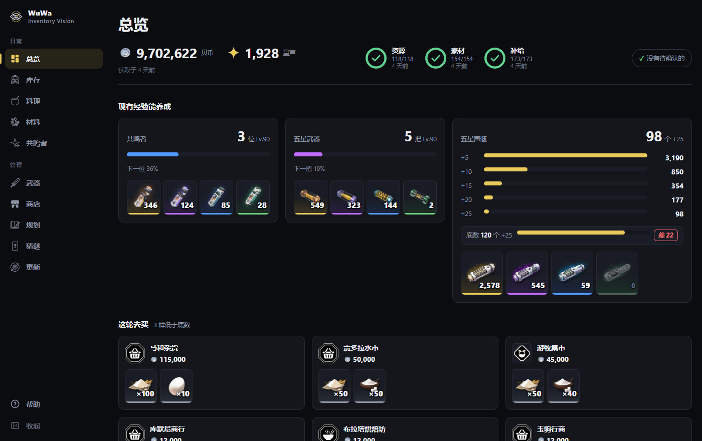
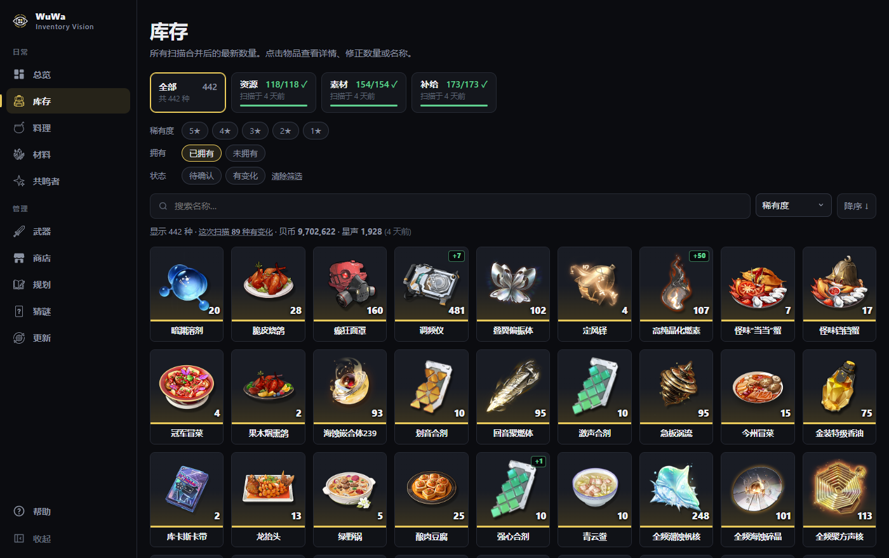
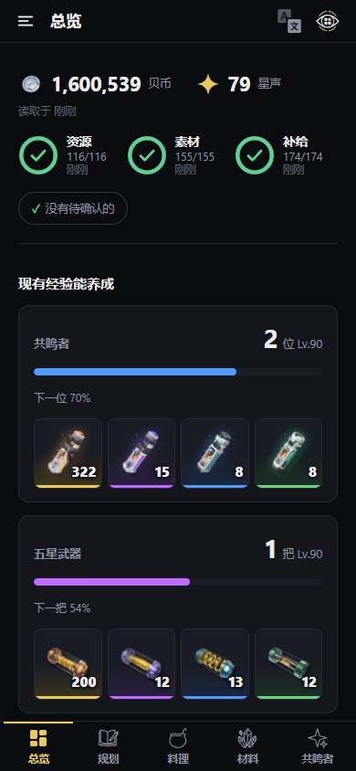

# WuWa Inventory Vision

Reads your Wuthering Waves inventory **off the screen** and turns it into a queryable list of
items and counts — then works out what you still have to farm. It never touches the game's files,
memory, or network traffic; only pixels.



**Ground rules, which nothing in here breaks:** screen pixels and OS input APIs only, no memory
reads, no injection, no packet capture. Menu-scoped; nothing that changes your account. Everything
runs on `127.0.0.1` and the one network call is a button you press. The player UID is stripped from
every frame before it is saved or shown.

## What it does

- **Scans the bag while you scroll it.** Open the inventory, scroll by hand, and it reads each
  item's name, rarity and count — and for weapons the level, 谐振 rank and who has it equipped.
  Each tab is checked against the game's own header count, so a scan knows when it is complete.
- **总览** — where it opens: what your stock can pay for, what is short, and how fresh the scans are.
- **库存** — everything you own, merged across scans, searchable, with each item's sources and uses,
  and for anything a shop sells, every shop's limit and price.

  

- **材料** — every build material against a full build, with synthesis counted and your own targets.
- **共鸣者** and **武器** — who and what you have, how far each is, what each still needs, which
  weapon each resonator carries, and what your spare weapon copies merge into.
- **料理** — dishes and potions against the stock you want kept, and what you can cook now.
- **商店** — every shop's shelf, by region: limits, prices, and the least you want to keep of
  each thing (for 密音筒, how many five-star echoes to +25).
- **规划** — plans from a current level to a target, totalled against your stock.
- **猜谜** — a daily game: guess the resonator from ten things the catalogue knows about them.
  Three levels that tell you less and less, and free rounds after.
- **更新** — pull the catalogue after a patch, import your pull history, fix what the wiki lacks.
- **帮助** — how to start, in four drawn steps; what each page is for; what to do when something
  does not work. The first time the app opens, a short guide walks through 总览.
- **On a phone too** — the same pages laid out for a thumb: a tab bar, a drawer, filters as a
  sheet, and the back gesture closing whatever is open. Everything is found by Chinese, pinyin,
  initials or English -- items, dishes, materials, resonators, weapons and shops alike; the
  English names come from the game's own English text, and 更新 lets you correct any of them.
- **In English too** — every page again under `/en` (`/en/inventory`, …), its own words in
  English and every game name English first, the Chinese under it. The 中文 / English button at
  the foot of the left column opens the same page in the other language; Chinese is the default.



## How it goes

| | | |
|---|---|---|
| 1 | **Set up** — one command installs everything and downloads the catalogue | [docs/setup.md](docs/setup.md) |
| 2 | **Scan** — start `live`, alt-tab into the game, scroll each tab | [docs/scanning.md](docs/scanning.md) |
| 3 | **Use the dashboard** — open the app and see what to farm | [docs/dashboard.md](docs/dashboard.md) |
| + | **Optional: the dashboard on a NAS** — always on, scans sent to it from the PC | [docs/nas.md](docs/nas.md) |

**Releases** come in three zips, each with a `START-HERE.md` that says how to set it up:
**full** (scanner and dashboard on one PC), **scanner** (the PC with the game, sending to a
home), and **home** (the dashboard on a NAS: a ready-made image with Tailscale beside it, deployed
from the NAS's Docker app). On a PC each step is a file to double-click.

The short version, on Windows:

```bash
powershell -ExecutionPolicy Bypass -File setup.ps1
```

```bash
uv run python -m wuwa_vision live --identify
```

```bash
uv run python -m wuwa_vision serve
```

The first installs (macOS: `./setup.sh`). The second scans: alt-tab into the game, scroll the bag,
press **F9** when done. The third serves the dashboard at <http://127.0.0.1:4000> — and, if Tailscale is connected, to
your own other devices at the tailnet address it prints. No dataset is
needed — see setup.

## Where it runs

Windows is the tested path (2560×1600 live; 21:9 and other sizes from replayed screenshots — nothing
is hard-coded to a screen size). macOS support is written but untested on hardware, and is
passive-only. An NVIDIA GPU makes recognition much faster; CPU works.

## Licence and credits

The code is under the [Apache License, Version 2.0](LICENSE). If you reuse, redistribute or
build on it — the scanner above all — keep the [NOTICE](NOTICE) and the copyright notices in the
source files, say what you changed, and credit **WuWa Inventory Vision by oguessyky**.
[TERMS.md](TERMS.md) says how the project asks to be used: no scraping of a copy the author
runs, nothing that automates the game, and no passing a changed version off under this name.
The licence covers this project's own code and documentation and nothing else.

This is an unofficial, fan-made tool, not affiliated with or endorsed by Kuro Games.
*Wuthering Waves* and everything from it — names, icons, portraits, artwork, screenshots — belong
to Kuro Games; the app ships none of the game's images, and downloads them to your own computer
from the sources named in [CREDITS.md](CREDITS.md). That file also says where the data and the
interface icons come from and lists the software this is built with. The app says the same on its
版权与致谢 page.

[PRIVACY.md](PRIVACY.md) is the privacy policy: everything stays on your own computer, nothing is
sent to the author, and the few times the app talks to anything else are each started by you
(updating the catalogue, sharing with your own tailnet, a home server you set up). It is in
English, which is the binding text, with a [Chinese translation](PRIVACY.zh-CN.md) for
reference; the app shows both on its 隐私政策 page.

## About this repository

This is the source of each release, at <https://github.com/oguessyky/wuwa-inventory-vision>; the packages are on its
[releases page](https://github.com/oguessyky/wuwa-inventory-vision/releases). The project is developed in a private repository, which
also holds the design record -- the `D` numbers in these docs (D70, D145, …) are its entries --
the tests, and the source of the pages, which ship here already built
(`src/wuwa_vision/web/ui/`).
