# The dashboard

The main app: every page, and what each one is for. Install first ([setup](setup.md)); the pages
fill in as you [scan](scanning.md).

```bash
uv run python -m wuwa_vision serve
```

Open <http://127.0.0.1:4000>. It is separate from the scan monitor (`live`, port 8711) and both can
run at once. Every page is a view of the same database, so a correction made anywhere shows up
everywhere.

The pages are in a column down the left, in two groups: the ones you look at daily (总览, 库存,
料理, 材料, 共鸣者) and the ones for managing things (武器, 商店, 规划, 猜谜, 更新). The app's icon at
the top leads back to 总览. The button at the column's foot folds it to a rail of icons, and the
browser remembers that; a window narrower than about 1100 px shows the rail by itself. 帮助, and
the scan monitor while a scan runs, are at the foot of the column too.

**The first time you open the app**, a short guide walks through it page by page -- 总览, 库存
(the filters, the search, and an item's panel), 材料, 商店, 更新, 帮助 -- with sample data, so every part it points at is
there even before your first scan (your own data comes back when it ends); lighting one part at a time with a few words on it (nine steps, "3 / 9"
on the card). Leave it with ✕ or Esc; ← and → step through it; 帮助's **新手引导** button starts it
again.

**Two pages have a guide of their own**, where the walk does not say enough: **猜谜**, which
teaches the game (the modes, the levels, typing a guess, what the colours mean -- drawn in the
card -- the tries and the streak), and **更新**, which goes through its parts and ends on
我的共鸣者: a resonator you got from an event or a gift is not in a pull history, so you turn its
switch on there. Each starts the first time you open the page after the walk, and **本页引导** --
at the foot of the column, or the ▶ in a phone's bar -- starts it again. On a phone, going back
closes a guide first.

**帮助** shows how to start in four drawn steps, what to do when something does not work, and
what every page is for. Every command on it has a **复制** button. Each problem -- a scan that
stops, F9 taken, a red tile, a wrong count, a phone that cannot connect, and more -- is drawn as it
looks, and opens to numbered steps with the commands to copy.

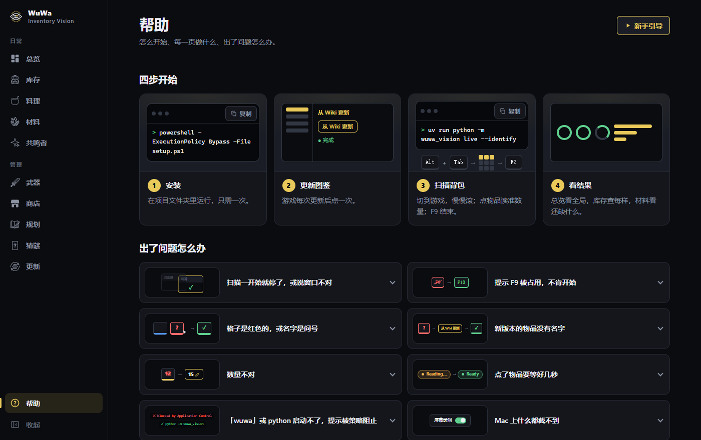

## On a phone

Open the same address on a phone and the layout changes for it:


- **Every search box takes pinyin, initials and English.** 声核 is found by `shenghe` or `sh`,
  金阳凤 by `jyf`, 面粉 by `flour`; a dish is found by an ingredient's pinyin too. Every item,
  dish, resonator, weapon and shop has its English name (D163).
- **The five pages you look at daily are a tab bar along the bottom**: 总览, 库存, 料理, 材料 and
  共鸣者. The menu button at the top
  left opens a drawer with every page in it, 武器, 商店, 规划, 猜谜 and 更新 included. Close it with ✕, a tap
  beside it, a swipe to the left, or by going back.
- **The filter chips fold into a sheet** behind one **筛选** button, which says how many are
  picked and which. While anything is picked, **清除** beside it clears the lot in one tap.
- **Tap a tile for its panel.** There are no hover cards on touch, and the panel says what a card
  would have. Counts, targets and the 食谱 tick can be fixed from there. To leave the panel, go
  back the way your phone goes back, or swipe it to the right; ✕ still works. If you opened
  something inside the panel, going back returns to what you were looking at first.
- **On 更新**, the page is first a list of its parts; tap one to go into it, and ‹ 更新 (or
  going back) returns to the list. 我的共鸣者 and 手动修改 are boxes whose lists scroll inside
  them; picking something in 手动修改 brings its form up. The forms are the desktop ones, stacked.

Whatever opens over the page works the same way: the pickers on 规划, the filter sheet, the
material picker, a question the app asks. Going back closes the newest one; a question that could
lose data takes going back as 取消.

The Back button closes these, and the panel, on a computer too.

## Finding anything in English

Every search box takes the English name too, in any case and in part: `flour` finds 面粉,
`shorekeeper` 守岸人, `emerald` 千古洑流, `rinascita` every shop in 黎那汐塔. The English names come
from the game's own English text (`tools/fetch_english.py`, run by 从 Wiki 更新), and an item's
panel shows its English name under its Chinese one.

The pages themselves are in English too, under `/en` (D164): `/en/inventory`, `/en/update/hand`,
and so on. The button at the foot of the left column (in the menu, on a phone) opens the page you
are on in the other language, keeping what it shows; Chinese is what the plain addresses are, and
the default. On an English page a game name is its English name first with the Chinese one small
under it, a name with no English one shows its Chinese, and what the wiki itself says (an item's
description, where to get it) stays in the wiki's words.

**更新 › 识别** (`/update/recognized`) shows what the scanners have learned: every picture saved
from the game under a name, which every later scan recognises things by. Each name is a row with
the catalogue's own picture beside the pictures from the game. Where the catalogue is sure a
picture is something else, the picture has a red ring and a ?, the row says 可能认错, and such
rows come first (the 可能认错 chip shows only them). Click a picture to rename it -- the
catalogue's guess is offered first -- or to clear its name. The change reaches every crop of the
same picture and the scans that saw it; on the home, every scanner takes it at its next fetch.
When the flag is wrong -- the name is right after all -- the same sheet has 名字没错：是…; the
picture and its copies under that name stay unflagged until they are renamed (D167). The
sheet's search takes pinyin and initials, and its buttons show each name's catalogue picture.
An item's panel links here when anything was learned under its name (识别记录 N 张 →).

**更新 › 英文名** lists every name with its English name and where that came from (游戏数据,
手动, or the pulls and the wiki for the few the game's table does not name). Click an English name
to change it; what you type is kept over the game's, marked 手动, and ↺ puts the game's back. The
chips find a kind (资源, 共鸣者, 商店 ...) or the names with none.

## Whose things these are

The footer of every page is one line: that the tool is unofficial, then 帮助, **版权与致谢**,
使用条款 and **隐私政策**. 版权与致谢 says the tool is unofficial and has nothing to do with Kuro Games, the game's pictures
and names are Kuro's, and lists where the data and the interface icons come from and what
software this is built with. `CREDITS.md` in the repository is the same record in full.

**隐私政策** is `PRIVACY.md`, shown as it is: what the app keeps, where, and the few times
something leaves your computer -- each one something you start. The English text is the binding
one; a Chinese translation is a tab away, for reference.

## From another device

If [Tailscale](https://tailscale.com) is installed and connected on this PC, `serve` also shares
the app with **your own tailnet** and prints the address:

```
  main app: http://127.0.0.1:4000
  tailnet : http://your-pc.your-tailnet.ts.net:4000
```

Open the second one on a phone or laptop signed in to the same tailnet. Use the name, not the
`100.x` address — Tailscale's share answers to the name only.

- The app itself still listens on this PC only. Tailscale forwards to it; nothing is opened on your
  home network or the internet.
- The share lasts while `serve` runs and ends with it, however it ends.
- **There is no login.** Every device on your tailnet sees your inventory and can use every button,
  including 清空扫描数据. If your tailnet has other people on it, run with `--local`:

```bash
uv run python -m wuwa_vision serve --local
```

Without Tailscale nothing is shared, and the tailnet line says why.

The share lasts only while this PC is on. To have the dashboard always there, put it on a box
that is always on and let this PC send its scans to it: [the dashboard on a NAS](nas.md).

How many of a weapon you own is one number everywhere: your bag, once the 武器 tab has been scanned
completely; the pull history only until then.

## 总览 — where the app opens


Drawn rather than written, and every number on it is one another page shows. Nothing is set
here; each group leads to the page that owns it, and a tile opens its item.

- **The strip.** 贝币 and 星声 as the last scan read them. A ring per bag tab: full and ticked
  when its last scan read everything, the share it read when not. How many items still wait
  to be told apart, and on a scanner with a [home](nas.md) how many scans are not sent yet.
- **现有经验能养成.** How many resonators and five-star weapons your EXP items take to Lv.90,
  with a bar towards the next one; and for echoes a bar per tier, +5 to +25, each "if all of
  it went there" and counted in EXP alone. The items themselves are the tiles underneath.
  With a 底数 on 密音筒 (below), a line under the echoes' bars says how many +25 your EXP is
  enough for against it; click it for a tube's panel and the exchanges that sell them.
- **这轮去买.** Everything below the 底数 you gave it, as one round of the shops: a block per
  shop with its picture, what that stop costs, and the things to pick up there with ×N,
  cheapest first. What one round cannot cover is said under it.
- **料理低于目标** and **规划还缺的材料.** Tiles with 缺 N and owned / wanted, the worst first,
  two rows at most and a link to the rest; the plans' faces are above theirs.

A group with nothing to show says why: no wallet read yet, no plan, the shop table not fetched.

## 库存 — what you own


Merges every scan into what you own now: each item's newest reading, with when it was read. A
partial rescan updates only what it saw; an item missing from a newer complete scan of its tab
shows as used up (已用完). 资源 / 素材 / 补给 each show their scan progress against the game's own
header count.

Every page filters and sorts the same way: lines of chips on top (one question per line; chips
on a line are alternatives, lines narrow each other), then the search box with the sort beside it
and a button for its direction — 降序 ↓ / 升序 ↑, click to turn the list around.

Here the chips are 稀有度, **拥有** (已拥有 is picked as the page
opens; add 未拥有 for the whole catalogue including what you have not scanned) and **状态** —
待确认 (unnamed or look-alike items that still need a click in game) and 有变化 (what the last scan
moved).

Rest the pointer on anything for a card about it — a material's family, a dish's ingredients,
what a resonator is still short of — and **move onto the card to click what it shows**: the
material opens directly, without opening the thing you hovered first.

Click an item for its
description, effect, where it comes from, what it is made of (owned / needed), which 食谱 teaches
it, and what it is used in — including **which resonators and weapons still need it**, counted
against how far each one actually is rather than against a full build. Counts can be corrected
there (a hand-set count holds until a later scan reads that item again), and so can names.

**What a shop sells says where, how many and for how much.** Under 获取途径 the panel has a
table: a line per shop with its picture, how many it lets you buy (`50/周`: every shop that is
not an exchange starts over weekly, and the wiki's word is used where it has a different one; an
exchange's bare number is because nothing says), and the price beside the coin.
The numbers are the game's own table (`tools/fetch_shops.py`, run by 更新), which knows more
shops than the wiki's 获取途径 does. The limit is the shop's, not what you have left of it this
time round.

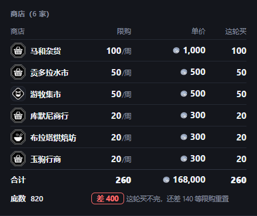

**底数**, the last line of that table, is the least you want to keep of the item; 0 is none. It
is another number than 目标: 目标 is still your answer when you set it, and the 底数 is the least
it can be. Below its 底数 the table grows a column, 这轮买: how many to buy in each shop this
round, cheapest first, with the total and what it comes to at the foot, and what has to wait
until the limits have started over.

**An ingredient's dishes are in one place.** 可用于制作 starts with 还缺的料理要用: the dishes
below their targets that take it, each tile saying 需 N. They add up to what 料理 asks of it.
Everything else it goes into is folded under its type's heading (菜肴 30) until you click it.

An EXP item (共鸣促剂, 能源核心, 密音筒) says what everything you own of its kind is worth: for
密音筒, how many five-star echoes it takes to +5, +10, +15, +20 and +25.

**密音筒's 底数 is counted in echoes**: how many five-star echoes from +0 to +25 you want the EXP
for, one number for all four tubes. Under it: how many your EXP is enough for now, 差 N 个 +25
with the EXP that is, and every exchange that sells a tube with what its limit would add. There
is no round of buying for it, because every tube a shop sells is paid in that exchange's own
currency.

## 商店 — every shop's shelf

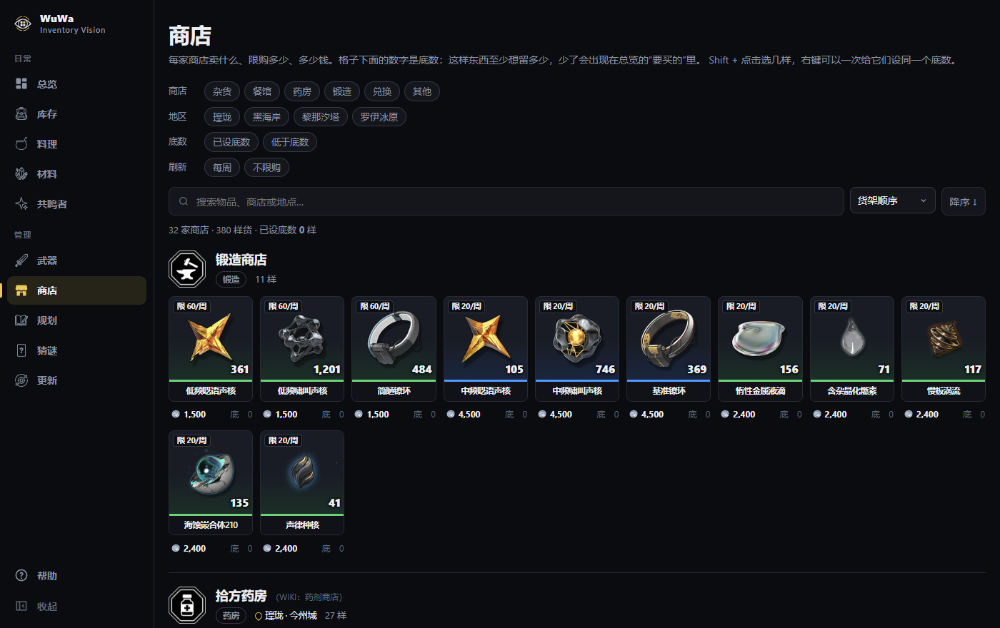

Every shop with its picture (the wiki's for the few it has a page for; for the rest a marker of
its kind -- 杂货, 餐馆, 药房, 锻造, 兑换 or 其他 -- drawn the way a map marks a shop), where it is
on the game's map (country and town), its keeper where known, and what it sells as tiles: the
limit, how many you have, the price. A shop that nothing names -- not the game's texts, its map,
or the wiki -- is left out: there is nowhere to go and buy from it.

- **The number under a tile is its 底数.** Type one to say "keep at least this many"; 0 takes
  it away. The same thing on another shop's shelf shows the same number: it is the thing's.
  A 密音筒's says +25 instead of 底: its number is five-star echoes, the same on all four.
- **Several at once:** Shift + click a few tiles, then right-click (or 操作… on the bar) for
  设底数… or 清除底数.
- Chips for the kind of shop, 地区 (瑝珑, 黑海岸, 黎那汐塔, 罗伊冰原), 已设底数 / 低于底数, and
  每周 / 不限购; search takes a thing, a shop or a place, as written or in pinyin
  (`mahe`, `mhzh`, `lgnc`).

What falls below its 底数 is on 总览 as a round of buying.

## 料理 — cooking

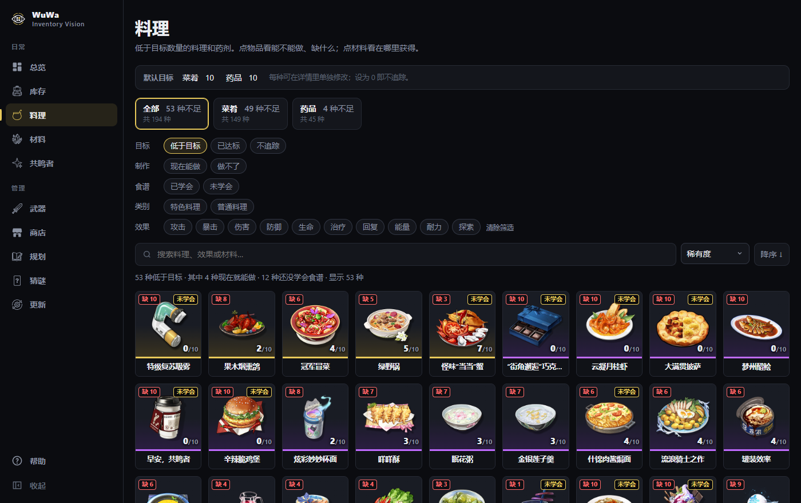

Dishes and potions below the amount you want kept, as tiles like 库存: owned / target on each,
"缺 N" when short, "可做 N" when you can make more now, "未学会" until you tick its 食谱 (a
resonator's own dish has none: it comes from cooking its base dish, whose 食谱 is the one to tick).
A dish whose resonator you do not have reads **做不出** and is not tracked: only they can cook it,
so whatever is in the bag came from the story. Targets
default per type (菜肴 10, 药品 5, editable at the top). The chips ask four things: **目标**
(低于目标 is picked as the page opens; 已达标 and 不追踪 are the rest), **制作** (what you can make
now), **食谱** (learned or not), **类别** — 特色料理 are the ones a specific resonator has to cook —
and **效果**, what the dish does: 攻击, 暴击, 伤害, 防御, 生命, 治疗, 回复, 能量, 耐力, 探索.

Click a tile for the same detail panel as 库存. Its **效果** section draws what the dish does
instead of leaving it as a sentence: a tile per thing it changes (the kind, the amount, the name),
then how long it lasts, its cooldown, whether it is for the team or one resonator, and any
condition. The game's own sentence is kept underneath. Below it, a 料理 section: its own target (0 = not
tracked), how many you can make now, and the 食谱/配方 tick (with where to get it until ticked).
Ingredients are listed owned / needed; **click an ingredient to see where to get it**, and
"‹ 返回" to go back.

## 材料 — what to farm

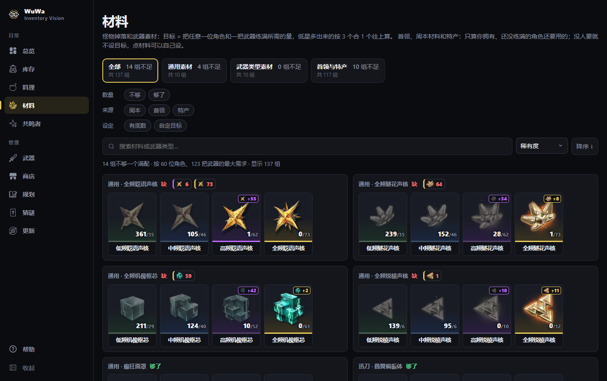

Every build material against a target. For enemy drops and weapon-type material the target is one
full build: the most any resonator needs of it plus the most any weapon needs (level 90, every
skill maxed). For what only some builds use — a boss drop, a weekly drop, a 特产, the 漂泊者's
神秘密码 — it is what a resonator **you have and have not finished** still needs; if nobody does,
there is no target and the tile shows the plain count. Set your own target to stock for someone
who is not out yet. Enemy drops and weapon-type materials are shown as
families, lowest tier first; a surplus below counts toward the tier above at 3 : 1 (shown as "+N",
in the tier's own colour so it is clear which pile it came out of). Boss, weekly and specialty
materials follow. A family's heading says which tier is short, and by how much (a boss or 特产 tile, which has no heading, says it in its own corner); the **数量** chips (不够 /
够了) keep one side or the other.

A material's panel says **where its target comes from** (目标 N 从哪来): the resonator and the
weapon behind the number, or the dishes below their target that eat it — each with its own amount,
each a click away. It also lists **who still needs it** — resonators and weapons, with the ones already
past it greyed out and pushed to the end (hover to bring one back).

You can also **set your own target**, for what is coming rather than what exists. One click stocks
a whole family — all four tiers — for 「角色+武器」, 「1 位角色」 or 「1 把武器」, using what one full
build of each costs; hover a set to preview its numbers first. The number field still fine-tunes a
single tier. The family's 恢复默认 puts it back to what the builds ask for, and the page's own
全部恢复默认 (next to the count at the top, only there when you have set any) clears every one of
them, after showing you which.

## 共鸣者 — resonators

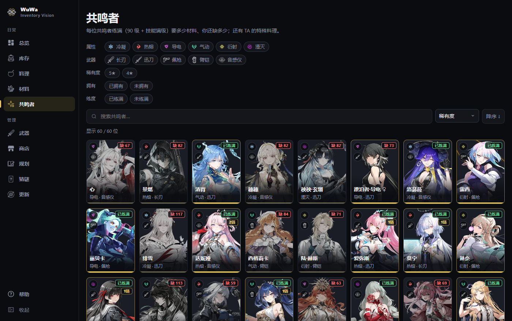

Every resonator as a card, sorted by rarity as the game does, with how many materials a full build
is still short and how many 共鸣链 you have.

The filters are separate questions — 属性, 武器, 稀有度, **拥有** (已拥有 / 未拥有) and **练度**
(已练满 / 未练满). Chips inside one group are alternatives; groups narrow each other, so 已拥有 +
未练满 is "the ones I have and have not finished".

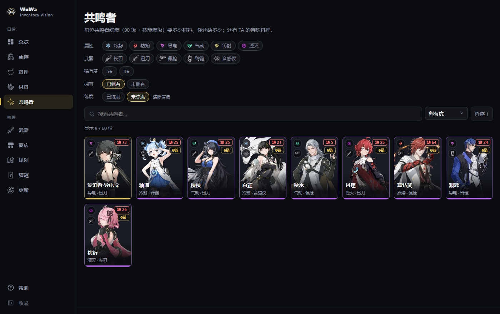

Click one for the 立绘 — **the weapon it has equipped sits on its bottom-right corner** (from the
武器 scan, with level and 谐振; click it for the weapon) — the profile, its 特殊料理 (click it for
the dish), the full build against your stock (synthesis counted)
and the weapons it can use — counted from your bag, the same number the 武器 page shows. The one
in hand comes first in that list.

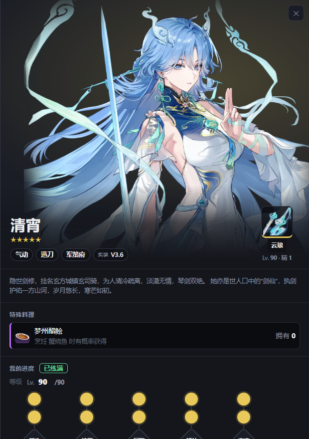

## 武器 — weapons

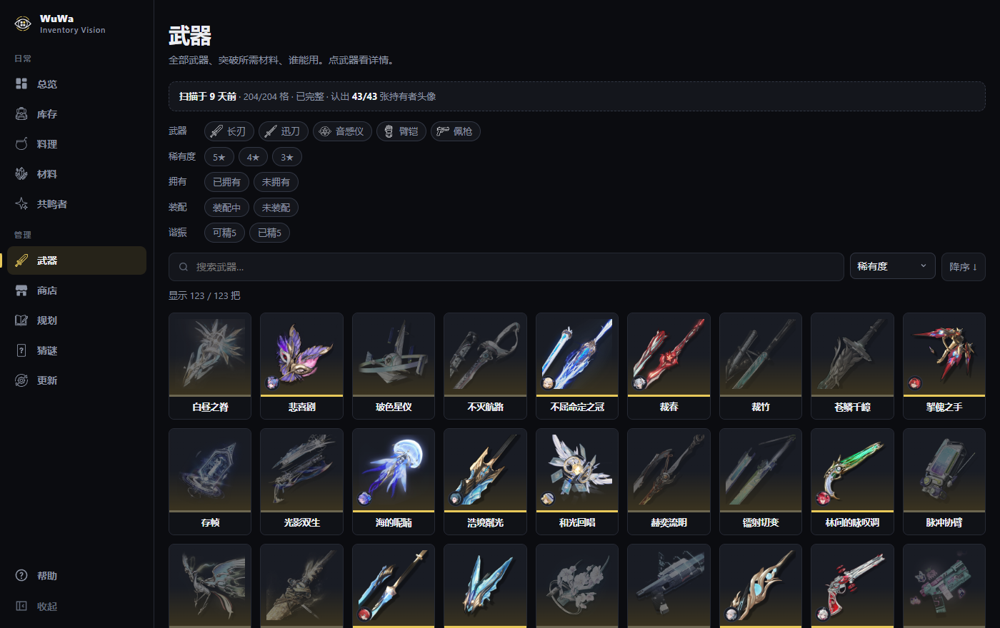

The five weapon-type icons (长刃, 迅刀, 佩枪, 臂铠, 音感仪) are drawings made for this app; it
ships none of the game's. To see other pictures instead, put your own files under the names listed
in `src/wuwa_vision/web/static/icons/game/README.md`, there or in `data/catalogue/avatars/`.

Every weapon by type and rarity. The filters work as on 共鸣者: **拥有** (已拥有 / 未拥有), **装配**
(装配中 / 未装配) and **谐振** (可精5 / 已精5) each narrow the list.

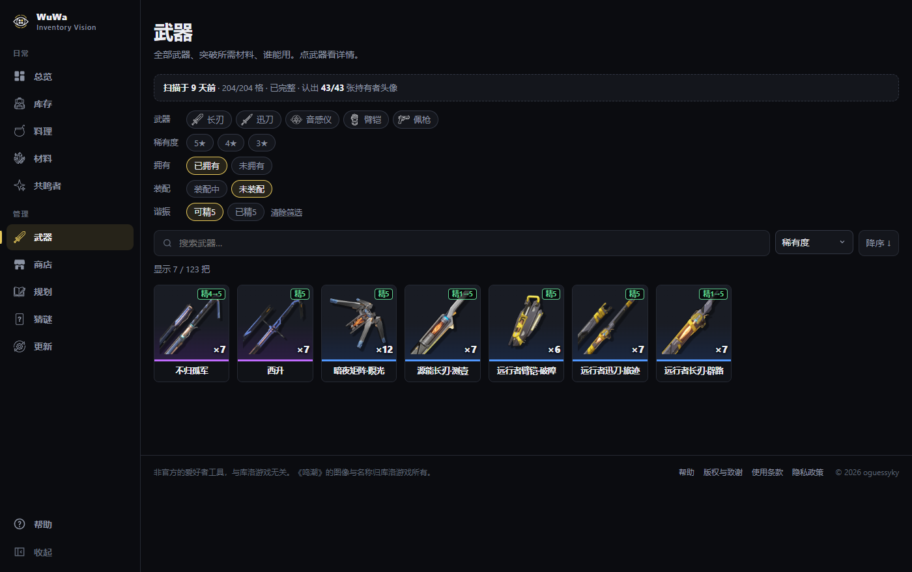

Hover a weapon for its copies as pictures: each copy someone carries, and the spare ones at the
same level and 谐振 collapsed into one icon with ×N.

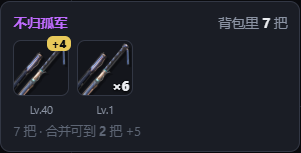

Click one for its ascension materials against your stock, who can use it, and what your copies add
up to — every 谐振 is +1 whatever you feed it, so the page says how many 精5 the copies you hold
merge into and what the remainder makes (*剩下 7 把能合出一把 +5*). 可精5 means the spare copies can
still reach +5, not that one already is.

**The bag outranks the pull history.** Importing wuwatracker's JSON on the 更新 page tells the app
which weapons you have pulled, but weapons get used up in 谐振 and sold; once a complete weapon scan
exists it wins, and a weapon the bag does not have says 背包里没有 instead of claiming a rank.

## 规划 — planner

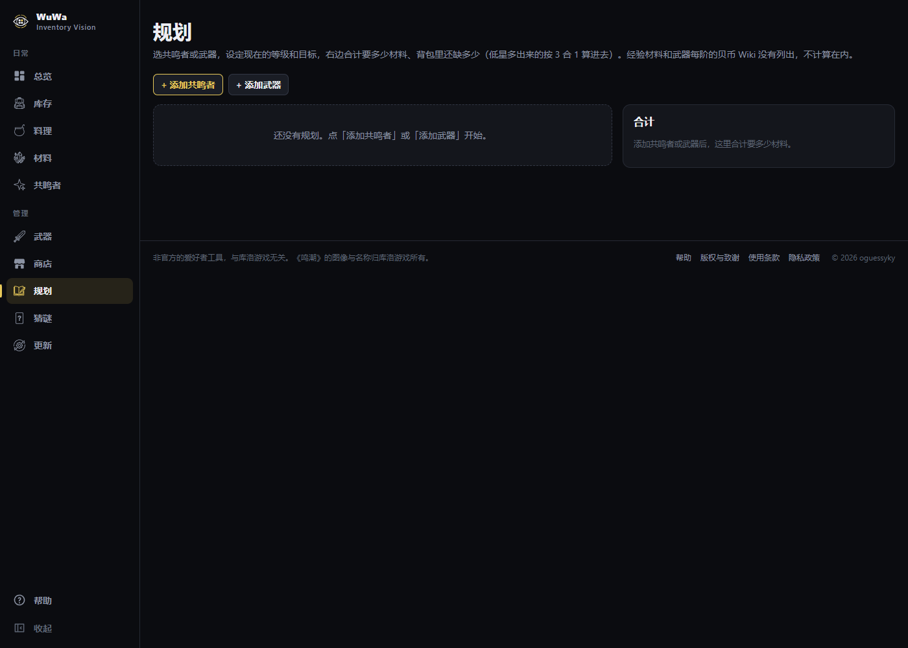

Add resonators and weapons (the picker has the same chips as their pages: 属性, 武器, 稀有度, 拥有),
set each one's current and target (level cap, each skill's LV and 分支
nodes; a weapon's level cap), and it totals the materials the steps between take — per plan, and
all plans together against your stock with synthesis, as on 材料. A resonator's "current" is shared
with the rest of the app, so levelling one here updates 材料 and 库存 too. Plans are saved. EXP
materials and a weapon's per-ascension 贝币 are not in the wiki's tables and are not counted.

## 猜谜 — guess the resonator

One resonator a day (the day turns at 04:00, as the game's does), the same one on every machine
that has the same catalogue. Click the field and pick a face, or type a name -- Chinese, pinyin,
initials or English -- and press Enter. Each guess is a row of things about the one you
guessed: 属性, 武器, 实装版本, 出生, 所属, what their own dish does, and the 周本, 首领, 特产 and
敌人掉落 materials their build takes. How many of those are compared, and what you are told
about them, is the level:

| level | guesses | columns | what a guess tells you |
|---|---|---|---|
| 普通 | 5 | all ten | each cell is green (the same), yellow (partly) or red. 版本 is yellow for the same major version and has an arrow saying whether the answer is earlier or later. 料理效果 is green only for the very same dish, and yellow for a different dish with an effect in common |
| 困难 | 6 | eight: no 版本, no 料理效果 | green or red only |
| 噩梦 | 10 | the same eight | no colours: one number, how many of the eight are the same. Tap a cell to colour it green or red for yourself -- your own notes, which nothing checks. When the round is over your marks stay as they are, and a ✓ or ✗ in the corner of each says whether that mark was right; a cell you left unmarked stays unmarked |

A round that is lost lists the answer in a row of its own, value by value. On the two harder
levels a few resonators are the same in all eight columns (折枝 and 白芷): a row that is all
green and still not the answer says so, and it is the other one.

A guess is told one cell at a time: the row turns its cells over in order, and the result waits
for the last one (if your system asks for reduced motion, it is all shown at once).

Choose the level before the day's first guess; it cannot be changed after. Each day starts at
普通 whatever you played the day before (free rounds keep the level you last chose). 未知 and 无 are values
like any other: two resonators the wiki says 未知 about match on it. A daily win at any level
keeps the streak; running out of guesses, or a day not played, ends it. **自由** is as many more
rounds as you like, at any level, that never touch the streak. The round is kept in the save,
so one begun on the PC can be finished on a phone.

出生 is written out, because the app has no pictures of the game's regions and fetches none. If
you have your own, put them in `data/catalogue/avatars/` named for the place in pinyin
(`region-huanglong.webp` for 瑝珑, `region-linaxita.webp` for 黎那汐塔; `.png` works too) and the
cell shows the picture beside the name.

**English** switches this page alone: how to play, the page's labels, resonators' names, and the
game's own English for elements, weapon types, places and factions. Material names stay as the
catalogue writes them, beside their pictures.

## 更新 — after a patch

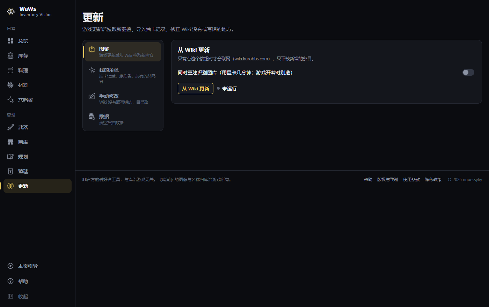

The page is in five parts, picked from the column on its left (on a phone, a list you go
into and come back from): **图鉴** (从 Wiki 更新), **我的角色** (导入抽卡记录, 我的漂泊者, 我的共鸣者), **手动修改**,
**英文名** and **数据** (清空扫描数据). Each part has its own address -- `/update/hand` opens 手动修改 (and an old `/update#hand` still does) -- and
the back button goes back through them. A fetch keeps running while another part is shown.

**从 Wiki 更新** runs the fetch tools (new items and icons, dishes, resonators, weapons, portraits,
level tables; only what is new) and lists what was added; optionally it rebuilds the recognition
gallery too. **This button is the app's only network access, and only when clicked.**

**导入抽卡记录** takes the JSON you export from wuwatracker yourself (the app downloads nothing
from that site). A resonator is matched by the English name in the file. A weapon is matched by
the names that ship with the app -- the game's own English name for each weapon, and pairings
other people made by hand -- and one that is newer than those names
is listed under the import with a **这是哪把？** button: pick it from the short list (already
narrowed to its type and rarity) and every later import knows it. 已手动认出 shows what you have
named and lets you take one back (a name the app already ships is not listed: there is nothing to take back).

If you maintain the project: `uv run python tools/make_pull_names.py` copies what you named into
`assets/pull_names.json`, which ships, so nobody after you has to name those again.
It reads: which resonators you have, how many 共鸣链, and how
many copies of each weapon. Only the counts are stored — never the player ID.

**我的漂泊者** picks 女 or 男 once (editable any time). The other side's four element forms are
hidden, and their materials stop being counted twice.

**我的共鸣者** is for who the pull history cannot see — given away, from an event, bought in a
shop, in a pack. Every resonator is listed with a switch for "on the account" and the 共鸣链 beside
it; what you set here outranks the pulls and is not touched by 清空扫描数据. Someone the pulls
already show cannot be switched off.

**清空扫描数据** starts the scans over when one went wrong: every scan, count, learned icon and
holder face goes; targets, plans, resonator progress, the pull history and settings stay. The
database and the scan crops are copied to `data/backups/<time>/` first.

**手动修改** is for what the wiki lacks or gets wrong — materials, material families, weapons,
resonators. The picker filters and sorts like every page (栏位, 类型, 属性, 稀有度 by kind, and
**状态**: 已手动修改 finds what you have changed, 没有材料表 the resonators the wiki has no table
for). Click an icon to edit that one, or 「+ 新建」 to add something the wiki does not have yet
(an unreleased character's materials, say). A resonator's or weapon's materials are asked for
by kind — 贝币, 怪物掉落, 武器素材, and for a resonator 首领材料, 特产 and 周本材料: click a box's
icon and the picker shows only that kind, highest tier first, with **the boss behind each boss
and weekly drop** (rest on one to see the boss large; type the boss's name to find it); **pick any tier of a family and all four
tiers are filled in**, with the amounts a build usually takes (填入常见数量 fills every amount left empty).
Hand edits live in `data/catalogue/overrides.json`, win
over the wiki, and survive installing a catalogue zip.

## Commands

All of these are prefixed with `uv run python -m wuwa_vision`:

| subcommand | what it does |
|---|---|
| `windows` | list windows, report what the capture guard sees |
| `live --identify` | capture the game live and scan; serves the live page |
| `scan <path> --identify` | scan a saved screenshot or a folder of them |
| `seed` | (re)build the gallery from the downloaded catalogue, or import the shipped pack |
| `pack` | write the gallery's reference entries to `assets/gallery_pack.npz` |
| `show --limit 40` | print the latest scan |
| `serve` | the main app (总览, 库存, 料理, 材料, 共鸣者, 武器, 商店, 规划, 猜谜, 更新) on 127.0.0.1:4000, shared with your tailnet when Tailscale is connected (`--local`: this PC only) |

`live` options are listed under [scanning](scanning.md#options); the fetch tools under
[setup](setup.md#where-everything-lives).
