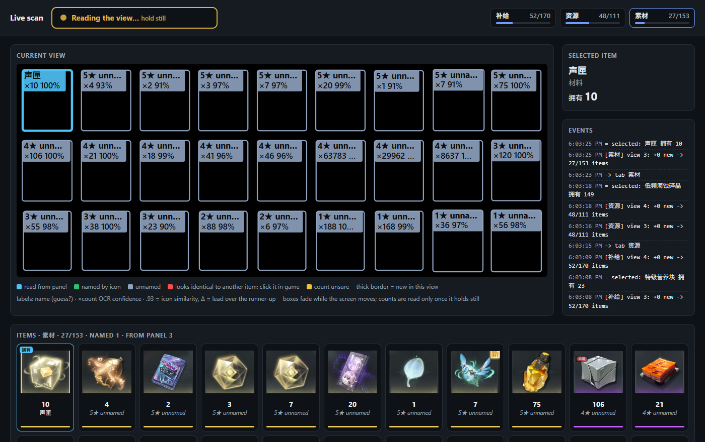
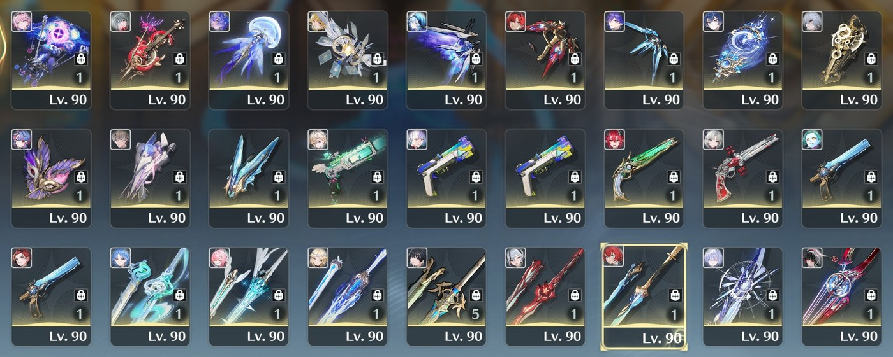
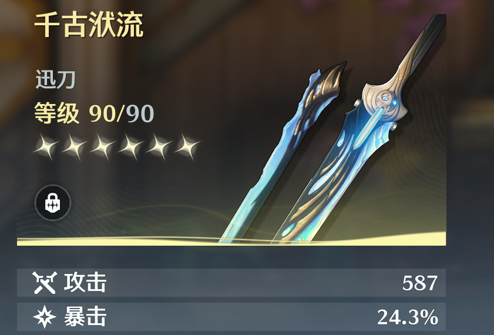

# Scanning

How to scan your inventory, and what the scanner does with what it sees. Install first:
[setup](setup.md). What the scan feeds: [the dashboard](dashboard.md).

## Running a scan

```bash
uv run python -m wuwa_vision windows
```

```bash
uv run python -m wuwa_vision live --identify
```

The first should print `guard: window OK`. The second starts the scan — then alt-tab into the game.
`uv run python -m wuwa_vision platform` says which OS it found and how `live` scans there
(D152): on macOS you **click into the game window** (or Cmd-Tab to it) instead of alt-tabbing,
and pointing the mouse at it is not enough.

`live` prints a countdown and **waits for you to alt-tab into the game** (`--wait`, default 60s)
before it reads anything. That wait exists because the guard can never pass at launch: you start
the command from a terminal, so the terminal is the foreground window.

The guard is re-checked **on every frame**. Capture only ever happens while the **game process**
owns the foreground window — a browser tab named "Wuthering Waves …" will not do. Alt-tab away
mid-scan and it pauses, keeping what it has; come back and it resumes. Stay away longer than
`--focus-grace` (default 120s) and the scan stops.

**F9** is the panic key: press it to stop, whether you are finished or something looks wrong
(on macOS, Ctrl+C). Everything read so far is kept. If another app already holds F9, `live` refuses
to start and prints which keys are free. Pass one of them, e.g. `--panic-key F10`.

Scroll the bag steadily by hand. The tool reads a frame each time the grid settles and ignores
mid-scroll frames. Each view it reads is printed as it happens: the items it just added, with
rarity and count. Scroll about a page at a time. Each view must share at least one row with the
previous one, or it warns that rows may have been skipped.

**Click an item** and its Chinese name and `拥有` count are read from the detail panel on the
right. That count is the game's own number, and it replaces the tile OCR. The name is remembered,
so the next scan names that item without another click. Items read this way are marked `=`.

**Watch it live.** `live` opens its page, `http://127.0.0.1:8711/live`, in your browser on this
PC (a second monitor is ideal; `--no-open` only prints the link). It lays the item grid out as
boxes on black, one per tile: its
name or best guess (`?`), its count with the OCR's confidence, and how sure the icon match is
(`.93 Δ.04`: similarity, and lead over the runner-up). `--preview` puts the game's own grid under
the boxes (~8 fps, grid only: no UID, no friend names); it is off by default because encoding it
costs CPU next to the game.
Boxes fade while the screen moves; counts are read only once it holds still. It also shows
per-tab progress, the selected item and the item list. Nothing is drawn over the game.
The banner at the top says when to act: **Ready** (green): scroll or click the next item.
**Reading…** (amber): hold still, it is reading the view or the item you clicked.
`--no-web` turns it off.



**One screen? Watch it on your phone.** With the game filling the PC's only screen, the live page
is behind it. `live --share` puts the scan's status on your phone instead, over
[Tailscale](https://tailscale.com) (installed and signed in on both the PC and the phone).
`扫描 Scan` and its shortcuts run it that way; a plain `live` keeps the scan to this PC:

```
uv run wuwa live --identify --share
```

It prints an address like `http://your-pc.your-tailnet.ts.net:8713`, and the top of the PC's live
page shows it with its port; a scan that was not shared says there how to share one. Open it on
the phone and
bookmark it: it is the same for every scan. Held upright the page shows the banner, filled with
its colour so it reads from arm's length, then each tab's progress, what the scan needs from you
(items to click apart, a view that did not overlap the one before, a tab that is complete), the
event log and the items. Turned sideways it adds the box grid. If it loses the scan it says so
and when it last heard from it.

- It can be looked at, and it can stop the scan. Fixing a name stays on the PC's page and in the
  main app.
- It never shows a picture of the game, whatever `--preview` says: boxes and names only.
- Only your own Tailscale devices can reach it, and only while the scan runs. Nothing is opened
  on your server network. Without Tailscale the scan runs as usual and says it is not shared.
- Set the phone's screen timeout long enough for the scan; the page does not keep it awake.

The picture is a demo replayed from saved frames, without the recognition gallery — in a real scan most
boxes carry a name (green) instead of `unnamed`.

**Switch tabs freely.** Each tab (资源, 素材, 补给 …) is a separate scan checked against its own
header count — the game's own number of unique entries, so a tab can say when it is complete.
Press the panic key when you are done; everything read so far is kept, and a list per tab is
printed.

**Some tabs are skipped.** 声骸 (echoes), 任务 (quest items) and 特殊 (special items) are never read
or saved; `live` says so when you open one. 武器 is read differently — see
[the 武器 tab](#the-武器-tab) below. `--skip-tab LABEL` (repeatable) replaces that list,
and `--all-tabs` scans everything.

**When you are done, close the page.** After the panic key the live page stays up so the final
tallies can be read. Close its tab and `live` ends by itself, a couple of seconds later; pressing
Enter in the terminal does the same, and is what is left if the page was never opened. A reload is
not a close. If the scan is still being sent to a [server](nas.md), it is sent first.

**Before it reads anything it learns the catalogue's new icons** (D85, D179): a patch that added
items -- updated here, or fetched from a [server](nas.md) a moment ago -- leaves reference icons nobody
has embedded. Only those are embedded, so it takes seconds, and the scan that follows a wiki update
names the new weapon itself. It says how many it learned; `--no-seed` turns it off.

A 5-star weapon the pull history does not list is asked about rather than named from its picture
(D101) -- unless the weapon is newer than the import: one the catalogue did not know when the
history was imported is not held against it (D179).

**A wrong name? Click it.** On the main page or the live page, click an item's name and type the
right one. The fix is kept and applied to every later read of that same misread, in every scan.
Most misreads never need this: panel names are snapped onto the official catalogue first.

**Every run is recorded** in `data/runs/<start time>/`: each view's grid picture, every tile's reads
and scores, count crops, panel crops (failed reads too), timings and an event log. It exists to
answer "what went wrong in that run". The last 5 runs are kept; `--no-record` turns it off.

## The 武器 tab

Weapons do not stack, so every tile is one copy and is read differently: its **level**, its
**谐振 rank** (the number on the tile is a rank, not a count), and the **portrait** of whoever has
it equipped. Click a weapon and the panel's "X装配中" names that portrait for good.

**5-star weapons are checked against your pull history.** If you imported your pulls on the 更新
page, a 5-star weapon recognised from its artwork alone that you never pulled is not trusted: the
tile asks for a click, and the game's own panel names it. This catches a look-alike being
mistaken for a weapon you do not own. Weapons the game gives away (血誓盟约, and now and then a
standard-banner 5-star from an event) are in no pull history, so each asks for one click, once —
after that the name is remembered. 4-star and below are never checked this way: too many come from
forging, shops and events.

A real run, from the recording in `data/runs/` (the grid only — the UID sits outside it and is
never saved). This is the first view of a 武器 scan as the scanner saw it, with the tile that had
been clicked outlined in gold:



And the panel that click opened, which is where the name comes from:



What the terminal said while it happened:

```
-> tab 武器
[武器] view 1: +27 new -> 27/204 items
= selected: 赝作的矮星  Lv.90 (音感仪)
! 2 item(s) look identical to other items -- click each to tell them apart: 苍鳞千嶂 / 不灭航路, 血誓盟约 / 苍鳞千嶂
[武器] view 2: +0 new -> 27/204 items
= selected: 千古洑流  Lv.90 (迅刀)
[武器] view 3: +0 new -> 27/204 items
= selected: 血誓盟约  Lv.90 (迅刀)
```

The `!` line is the pull-history check at work: two 5-star tiles whose best artwork match was a
weapon never pulled. One click each, and the panel named them 千古洑流 and 血誓盟约 — the scan
finished at 204/204.

## How it works

Each time the grid holds still, one frame goes through these steps:

1. **Guard.** The frame is only taken while the game process owns the foreground window.
2. **Find the tiles.** Tile panels are found by their outlines, with a regular-grid fit as the
   fallback. Nothing is measured in fixed pixels, and the column count is detected.
3. **Read each tile.** Rarity from the colour bar; the count by OCR (for weapons, level and rank).
4. **Name each tile.** The icon is embedded (DINOv2) and compared with the reference gallery —
   Kuro's official catalogue, shipped pre-embedded — plus every crop a panel has named before. A
   match has to be clearly ahead of the runner-up, or the tile stays unnamed rather than guessed.
5. **Read the panel**, if you clicked something: the game's own name and `拥有` count, which
   outrank everything above.
6. **Stitch.** The frame is placed against the rows already seen, so scrolling adds rows instead of
   duplicating them.
7. **Check.** The tab's header (`素材 153/1000`) is the game's own count of entries; a scan is only
   called complete when it found exactly that many.

Low-confidence reads are stored with their confidence and flagged, never promoted to fact. The
player UID is stripped before anything is saved or shown.

## Options

Useful `live` options: `--panic-key F10`, `--no-web` (no live page), `--no-open` (do not open it
in the browser), `--preview` (game picture on the live page), `--share` (status on your phone,
`--share-port 8713`), `--no-record`, `--no-seed`, `--port 8711`, `--skip-tab LABEL` / `--all-tabs`,
`--wait 60` (seconds to wait for you to alt-tab in), `--focus-grace 120`, `--seconds 1200` (time
budget).

`uv run python -m wuwa_vision scan <path> --identify` runs the same pipeline on a saved screenshot
or a folder of them, with the game closed.

## Resolution

Nothing is hard-coded to a screen size. Tile geometry is re-derived on every scan, and the
**column count is detected, not assumed** — a 21:9 capture renders 9 columns where a 3:2 capture
renders 6. A 2560×1600 laptop should work untouched.

Checked so far: 3439×1439 and 2940×1912 from screenshots, and 2560×1600 in live scans (tile
detection, stitching and the detail panel).

## Known limits

- **Items outside the catalogue are unnamed until you click them.** Anything newer than the shipped
  pack, or from other tabs, still scans correctly (counts, rarity, de-duplication) and gets its name
  from the detail panel once clicked.
- **Some different items share identical icons** (e.g. 撞金合剂 and 划音合剂, 激声合剂 and 强心合剂,
  the four 溶剂). Only the panel can tell them apart: such a tile turns **red** on the live page (`?`
  in the terminal) until you click it.
- **A click takes ~2.5–3 s to read** (panel OCR on the CPU). Hold still until the banner says Ready.
- **The live page works on this PC only.** It listens on 127.0.0.1, so a phone cannot open it.
- **Tested against the live game on one machine** (2560×1600, Windows). The recorded runs (D38–D44)
  shaped most of the live behaviour; other resolutions are covered by replayed screenshots only, and
  macOS by no hardware at all.
